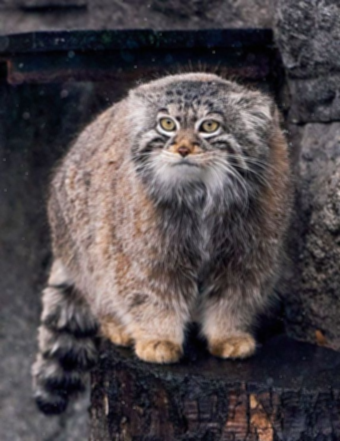

# Отчет

## Теория
В основе работы фильтра лежит свертка входного изображения функцией Гаусса.
$$ G(x,y) = \frac{1}{2\pi\sigma^2}e^-\frac{x^2+y^2}{2\sigma^2}$$
$\sigma$ - главный управляющий параметр (чем больше тем сильнее размытие)

## Описание разработанной системы 
1. **Абстрактный класс `Kernel`** — базовый интерфейс, задающий единый стандарт для всех типов фильтров через переопределение метода `__call__`.
2. **Класс `GaussianKernel`** — конкретная реализация фильтра размытия Гаусса. Выполняет автоматическую генерацию матрицы весов по заданному размеру (`size`) и отклонению (`sigma`), а также нормализует ядро (чтобы засветов и пересветов не было).

### Ключевой функционал

* **Генерация двумерного ядра Гаусса** с валидацией входных параметров (размер матрицы строго нечетный).
* **Поддержка многоканальности** (RGB/RGBA изображения) за счет независимой обработки каждого цветового канала.
* **Обработка границ** изображения с помощью паддинга типа `edge` (дублирование крайних пикселей), что предотвращает появление темных рамок по краям.
* **Свертка матрицы** попиксельный обход по каждому каналу.

### Листинг фильтра Гаусса 
```
class GaussianKernel(Kernel):

    def __init__(self, sigma: float, size: int):
        self.sigma = sigma
        if size % 2 == 0:
            raise  ValueError("Только нечетное число")

        self.size = size
        x, y = np.mgrid[:self.size, :self.size]
        self.kernel = (1/(2*np.pi*self.sigma**2)) * np.exp(-(x**2 + y**2)/ (2*self.sigma**2))
        print(self.kernel)
        self.kernel = self.kernel / self.kernel.sum()


    def __call__(self, X:np.ndarray):
        X = np.asarray(X)
        X = np.atleast_3d(X)
        X = np.moveaxis(X, -1, 0)

        c_axis,img_height, img_width =  X.shape
        pad_size = self.size // 2
        pad_mats = [np.pad(X[i], pad_width= ((pad_size, pad_size), (pad_size, pad_size)) , mode= "edge") for i in range(c_axis)]


        for k, ax in enumerate(pad_mats):

            for i in range(img_height):

                for j in range(img_width):
                    region = ax[i: i+self.size,j: j+self.size]
                    X[k,i,j] = np.sum(region * self.kernel)
        return  np.moveaxis(X, 0, -1 )

```
## Результаты работы
Для тестирования работы алгоритма возьмем фотографию живого символа Московского зоопарка — манула Тимофея.  
C $\sigma$ равной 4 и размером ядра 5x5

### Моя реализация

### Реализация opencv

### Сравнение по времени
**[TIME] Custom, duration 9.4271**  
**[TIME] cv2, duration 0.0014**


## Выводы по работе
В ходе данной лабораторной работе был реализован и протестирован алгоритм фильтра Гаусса. 
## Использованные источники
* **Теория:** [Gaussian Blur — Wikipedia](https://ru.wikipedia.org/wiki/%D0%A0%D0%B0%D0%B7%D0%BC%D1%8B%D1%82%D0%B8%D0%B5_%D0%BF%D0%BE_%D0%93%D0%B0%D1%83%D1%81%D1%81%D1%83) — подробное математическое описание и свойства размытия.
* **Инструменты:** Документация функции [cv2.GaussianBlur](https://opencv.org) в библиотеке OpenCV.